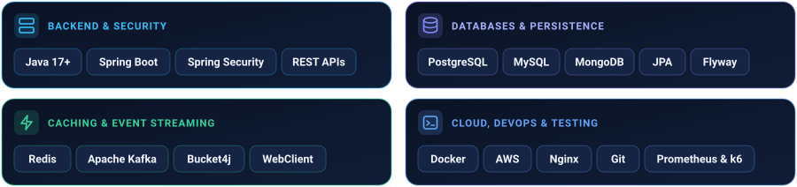

  <!-- Animated Hero Banner -->
  

   

  <!-- Top Prominent Contact & Portfolio Cards -->
  

    &nbsp;
    &nbsp;
    &nbsp;
    
  

  

  <!-- Structured Tech Stack Bento Grid -->
  <h3>Tech Stack</h3>

  

    
  

  

  <!-- Featured Projects Bento Table -->
  <h3>Featured Projects</h3>

<table>
  <tr>
    <td colspan="2">
      <h4>
        <a href="https://github.com/pablo483/Inventory-SAAS">Multi-Tenant Inventory Management SaaS</a>
        &nbsp;<code>Flagship Architecture</code>
      </h4>
      

        Production-style multi-tenant SaaS isolating organizations, stock transactions, reconciliation reports, and subscription plans.
        Features custom <code>TenantInterceptor</code> context isolation, <b>Flyway</b> migrations, <b>Redis</b> caching + Pub/Sub + sorted-set leaderboards,
        <b>Bucket4j</b> token-bucket rate limiting, <b>Prometheus</b> metrics, <b>k6</b> load scripts, and a 3-replica <b>Nginx + Docker Compose</b> stack paired with a React/TypeScript UI.
      

      

        <code>Java 17</code> <code>Spring Boot 3.5</code> <code>MySQL</code> <code>Flyway</code> <code>Redis</code> <code>Bucket4j</code> <code>Docker &amp; Nginx</code> <code>Prometheus &amp; k6</code> <code>React / TS</code>
        &nbsp;—&nbsp; <a href="https://github.com/pablo483/Inventory-SAAS"><b>View Repo →</b></a>
      

    </td>
  </tr>
  <tr>
    <td width="50%" valign="top">
      <h4><a href="https://github.com/pablo483/Ecommerce_Cloud">Ecommerce_Cloud</a></h4>
      

        Multi-vendor e-commerce REST API supporting <code>ADMIN</code>, <code>VENDOR</code>, and <code>USER</code> roles with <b>Cloudinary</b> multipart image uploads,
        paginated filtering/search, admin approval workflows, <b>Redis</b> caching, and daily <code>@Scheduled</code> low-stock vendor email alerts.
      

      

        <code>Java 17</code> <code>Spring Boot 3.4</code> <code>MongoDB</code> <code>JWT</code> <code>Redis</code> <code>Cloudinary</code>
      

    </td>
    <td width="50%" valign="top">
      <h4><a href="https://github.com/pablo483/external-api-integration">external-api-integration</a></h4>
      

        Event-driven third-party API gateway (Weather &amp; Currency) using reactive <code>WebClient</code>, <b>Redis</b> TTL read-through caching,
        and isolated asynchronous <b>Apache Kafka</b> audit event producer/consumer streams with manual offset commits.
      

      

        <code>Java 17</code> <code>Spring Boot 3.5</code> <code>WebClient</code> <code>Kafka</code> <code>Redis</code> <code>Docker</code>
      

    </td>
  </tr>
  <tr>
    <td width="50%" valign="top">
      <h4><a href="https://github.com/pablo483/online-quiz-backend">online-quiz-backend</a></h4>
      

        Online quiz &amp; automatic grading API (<a href="https://github.com/pablo483/Online-Quiz-Frontend">Frontend Repo</a>) with hierarchical categories,
        JWT + UUID refresh tokens, and <code>UserAttemptLog</code> tracking that prevents duplicate wrong-option guesses.
      

      

        <code>Spring Boot 3.5</code> <code>MySQL</code> <code>JPA</code> <code>JWT</code> <code>React 19</code>
      

    </td>
    <td width="50%" valign="top">
      <h4><a href="https://github.com/pablo483/UserOnboarding-API-Cookie">UserOnboarding-API-Cookie</a></h4>
      

        Security-focused onboarding service featuring email verification links, BCrypt hashing,
        <code>HttpOnly</code> <code>SameSite=Lax</code> cookie JWTs, and database-backed refresh token rotation to prevent replay attacks.
      

      

        <code>Java</code> <code>Spring Boot</code> <code>MySQL</code> <code>Spring Security</code> <code>JWT Cookies</code>
      

    </td>
  </tr>
</table>
